# Kalendář

(c) 2025, 2026 texty i foto: Josef Pelikán

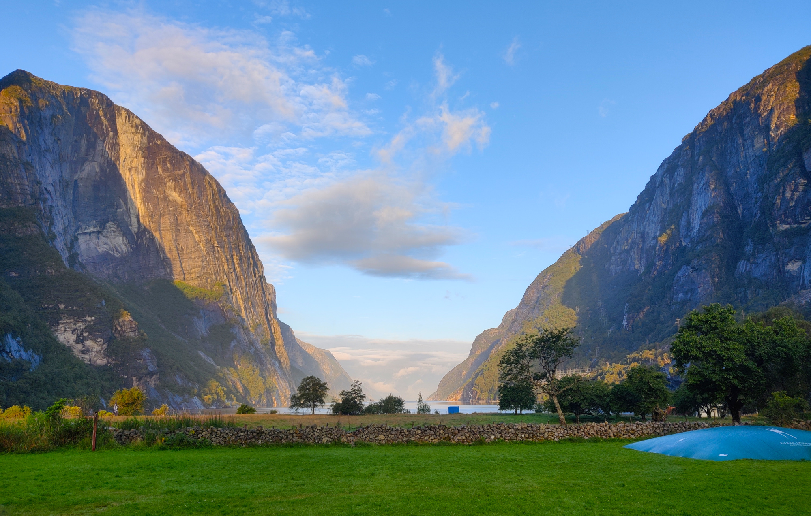

## 00. titulní stránka - Lysebotn

Foceno 11. 8. 2025 v kempu v Lysebotn. Den předtím jsem dorazil autem po silnici 4224 (Lysevegen) se slavnými serpentinami a dokonce jednou otočkou uprostřed kopce (Lysetunnelen), ve které cesta klesne na 1103 metrech o cca 100 metrů. Bylo bohužel dost špatné počasí, fotit nemělo moc smysl.

Na ráno jsem si naplánoval výlet lodí, a když jsem vyšel před sedmou hodinou ven, příroda nám připravila skvělé počasí! Aspoň tedy na tu chvilku, kdy jsme si zahráli na japonské turisty a fotili na všechny objektivy, co byly po ruce...

Později cestou lodí do Flørli už tak pěkně nebylo. Ve Flørli jsem se šel podívat asi sto schodů nahoru, ale pak se vrátil, protože se počasí horšilo a začínalo mrholit (další důvod, proč to nevylézt celé - prvním důvodem byl nedostatek času). Dřevěné schody Flørlitrappene (4444 schodů, prý nejdelší dřevěné schodiště světa) se smí chodit jen nahoru, kvůli bezpečnosti. Byl by to výlet cca na půl dne, dám si ho někdy příště...

<https://www.visitnorway.com/places-to-go/fjord-norway/the-stavanger-region/listings-stavanger/lysevegen-road-in-lysebotn/235453/>

<https://www.florli.no/>

<https://www.visitnorway.com/listings/hike-to-fl%C3%B8rlitrappene-and-rallarstien-in-the-lysefjord/238296/>

---

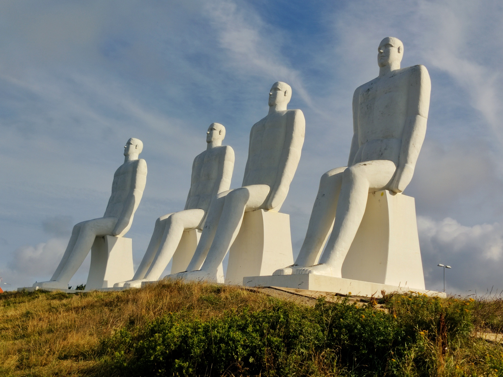

## DK Týden 01: Esbjerg, Men at Sea

Esbjerg je město, které jsem v minulé výpravě vynechal, tentokrát jsem si tam naplánoval nocleh v autě v přístavu a návštěvu blízkého ostrova Fanø. Díky inspiraci od Jana Buriana, cestovatele, písničkáře, básníka a spisovatele, jsem navštívil i toto známé sousoší. Je obtížné ho za pěkného počasí vyfotografovat
bez turistů.

<https://nl.wikipedia.org/wiki/Mannen_aan_de_Zee>

---

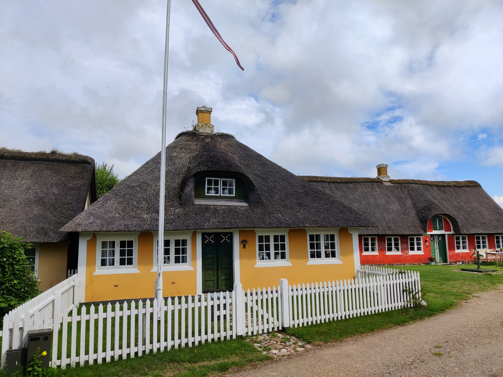

## DK Týden 02: Sønderho

Inspirován opět Janem Burianem jsem tentokrát zajel trajektem i na ostrov Fanø a tam navštívil vesnici Sønderho, prý nejkrásnější v Dánsku.
Mně se rozhodně líbila, i do řeči s jedním místním pánem jsem se dal. Jako kluka ho tam rodiče vozili každé prázdniny a nechávali u babičky a dědy. Celé týdny tam prý v létě neprší.
Když vyrostl, domek po prarodičích nezdědil, ale pořídil si jiný a rodinnou tradici hodlá prodloužit aspoň o generaci.
Pozn: to není ani jeden z domů na fotografii, ten jeho byl trochu méně fotogenický...

<https://www.vadehavskysten.com/ribe-esbjerg-fano/ribe-esbjerg-fano/sonderho-fano-denmarks-most-beautiful-village-gdk1010408>

---

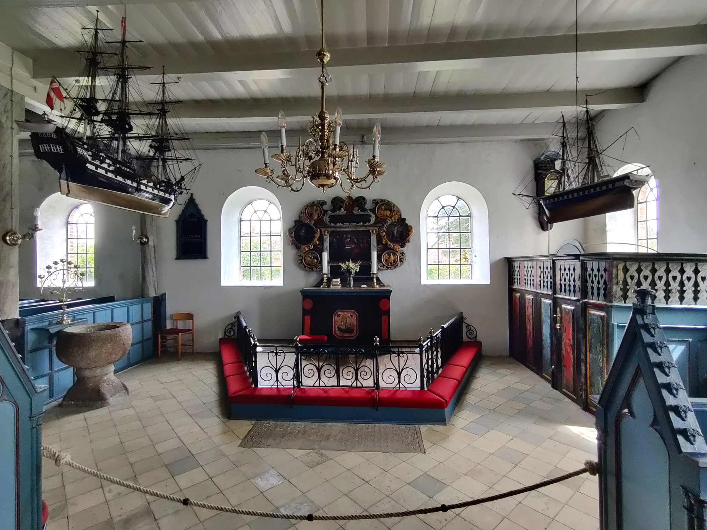

## DK Týden 03: Sønderho Kirke

Na ostrově Fanø jsem došel až k tomuto kostelu, který se ukázal velmi zajímavým - je v něm umístěna nejrozsáhlejší sbírka votivních modelů lodí - je jich tam patnáct!
Varhany z roku 2006 jsou umístěny v přízemí, tak si je můžete dobře prohlédnout. Jejich zvuk jsem ale neslyšel...

<https://de.wikipedia.org/wiki/S%C3%B8nderho_Kirke>

<https://en.wikipedia.org/wiki/Votive_ship>

---

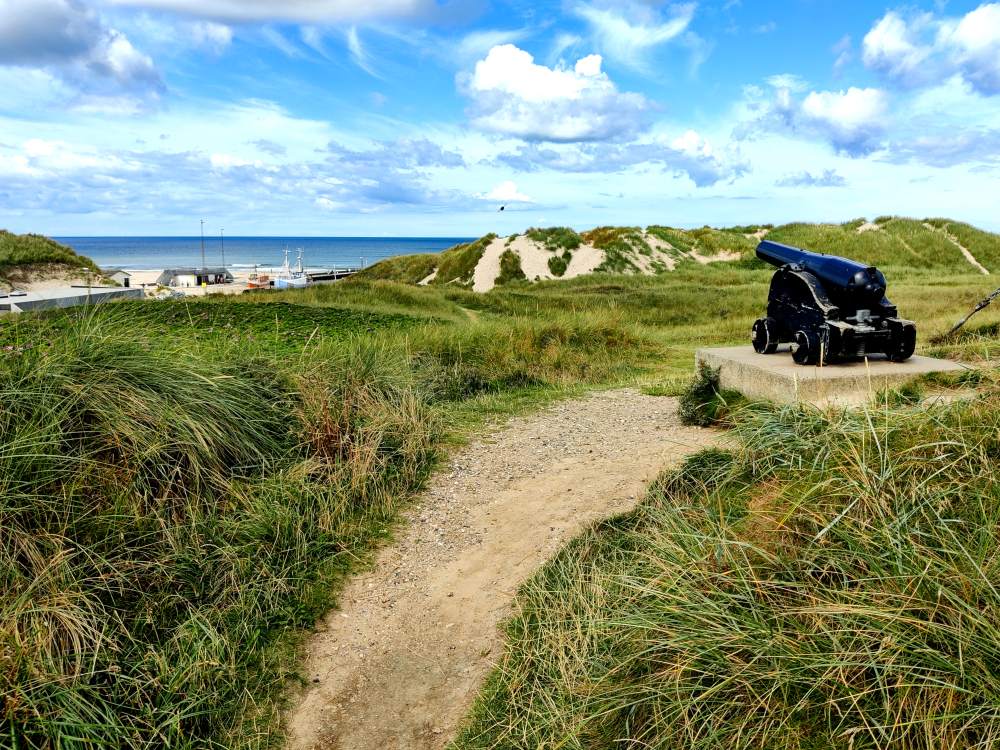

## DK Týden 04: Løkken

Původně rybářské městečko s krásnými plážemi, bunkry a dunami. Minule jsem ho nenavštívil, tak jsem se tam tentokrát zastavil na cestě z Thorup Strand do Aalborgu. To je opravdu krátká cesta, takže jsem mohl v Løkken strávit několik hodin. Procházel jsem se hlavně poblíž moře, protože to mám nejradši. Došel jsem od Sømærket (navigační věž) až k Løkken vandtårn (vodárenská věž). Fotografie je pořízená poblíž Faresignalstationen (stanice pro signalizaci nebezpečí).

Zajímavý zážitek z přístavu popíšu za týden.

<https://en.wikipedia.org/wiki/L%C3%B8kken,_Denmark>

<https://xn--lkkenkunststi-bnb.dk/en/the-9-landmarks/the-sea-mark/>

<https://xn--lkkenkunststi-bnb.dk/en/the-9-landmarks/the-danger-signal-station/>

---

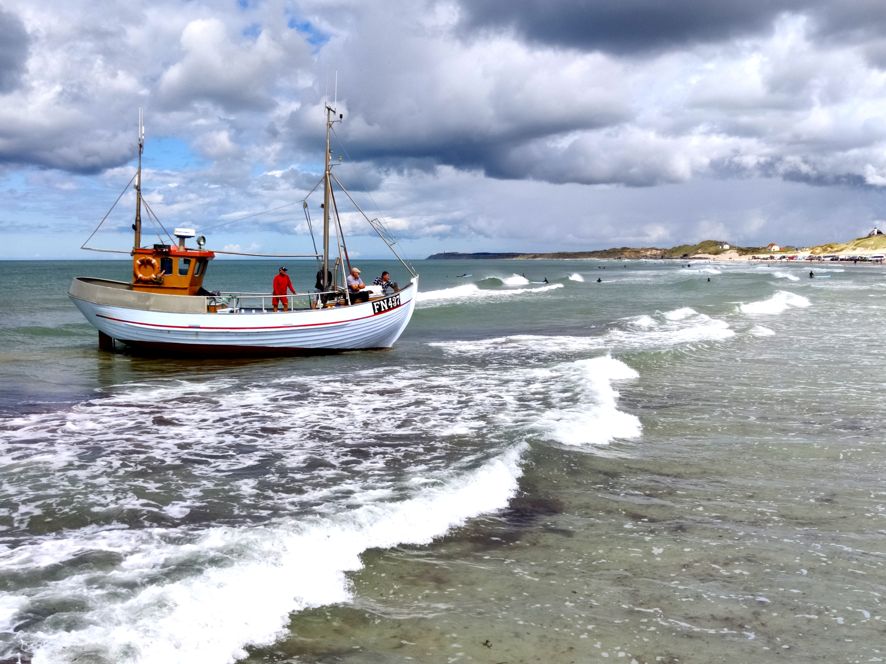

## DK Týden 05: Boat winching, Løkken Mole

Když najdete na letecké mapě Løkken Mole, všimněte si i lodí vytažených na břeh. Jednoho takového vytahování jsem byl svědkem. Podle množství okukujících lidí - turistů i místních - to je jen občasná podívaná.

Loď FN437 Bihama nejdřív přijela k molu (na severovýchodní straně, která je trochu chráněná proti vlnám) a čekala na asistenci z pevniny. Po molu přijel traktor, přitáhl z navíjecí stanice lano a společně s posádkou na něj loď přivázali. Pak už bylo vše v rukou obsluhy navijáku (domeček na břehu v prodloužení mola, kdybyste se stále dívali na leteckou mapu) a jednoho pomocníka, který měl na starost lano - přehazoval ho podle potřeby na různé kladky (se svislou osou otáčení) umístěné napevno na pláži. Pomalu dotáhli loď až na břeh, zjevně je konstruovaná tak, aby jí tažení po písku nepoškodilo. Celá akce trvala minimálně 20 minut.

<https://www.google.com/search?q=Boat+Winching+in+L%C3%B8kken>

---

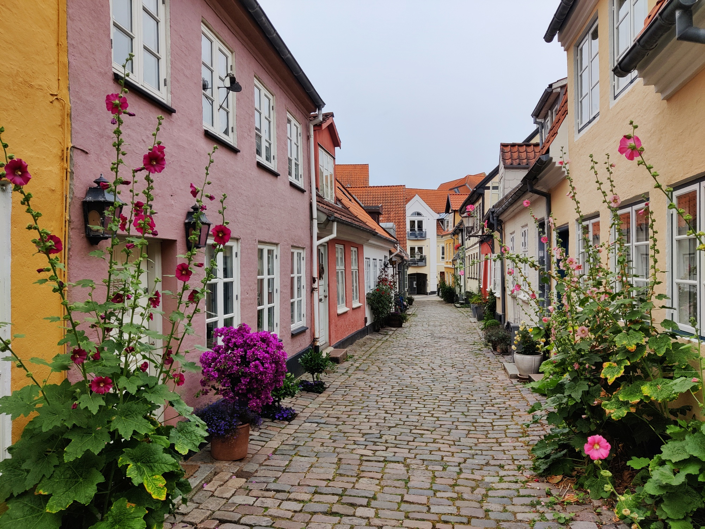

## DK Týden 06: Hjelmerstald, Aalborg

Na radu kamarádky Denisy jsem v Aalborgu navštívil Salling Rooftop (odtud se fotka do kalendáře nedostala) a hned kousek vedle známou historickou uličku Hjelmerstald. Bývá tu hodně turistů, ale já jsem měl štěstí a procházel se tam skoro sám. Skutečně tu bydlí lidé a sem tam tu objevíte krámek se starožitnostmi nebo bleší trh. Jméno uličky je odvozeno od faktu, že tu bývaly koňské stáje.

<https://www.enjoynordjylland.com/north-jutland/plan-your-trip/hjelmerstald-gdk798729>

<https://da.wikipedia.org/wiki/Hjelmerstald>

<https://aalborg-miniby.dk/hjelmerstald>

---

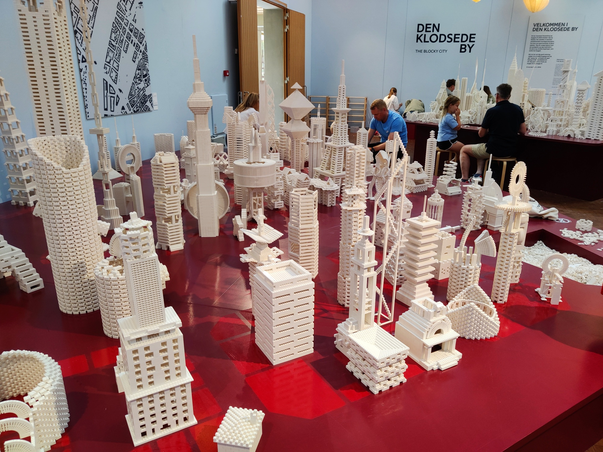

## DK Týden 07: Den klodsede by, Utzon Center, Aalborg

V Aalborgu jsem navštívil skvělé Utzon Center, ale nedávám sem žádnou obvyklou fotku střechy s válcovými plochami. Místo toho je tu zobrazen prostor, tak typický pro Dánsko -
dílna pro Lego a Minecraft. Děti i dospělí si zde mohou sednout, nechat se inspirovat již vystavenými objekty, hrábnout do hromady kostiček a začít tvořit (já jsem odolal, tušil jsem, že bych tam strávil příliš mnoho času, který jsem neměl).

Jørn Utzon spolu se synem Kimem centrum postavili v roce 2008 a věnovali ho architektuře a designu. Dodnes funguje jako pracovní místo pro ateliér Utzon, dokonce jsem někde našel výzvu, že se můžete potichu podívat i přímo do "kanceláří" architektů a designérů, když se předtím dovolíte. To jsem udělal, fotky soukromějších prostor samozřejmě vystavovat nemohu.

Asi nejznámější instalace ateliéru je opera v Sydney, je jí věnována jedna celá místnost, tam se můžete dozvědět mnoho detailů z práce na projektu opery. V Sydney je zase koncertní místnost "Utzon Room".

Centrum má i svou restauraci, která se jmenuje Jørn.

<https://utzoncenter.dk/den-klodsede-lego-minecraft-og-virtual-reality-104>

<https://utzoncenter.dk/en>

---

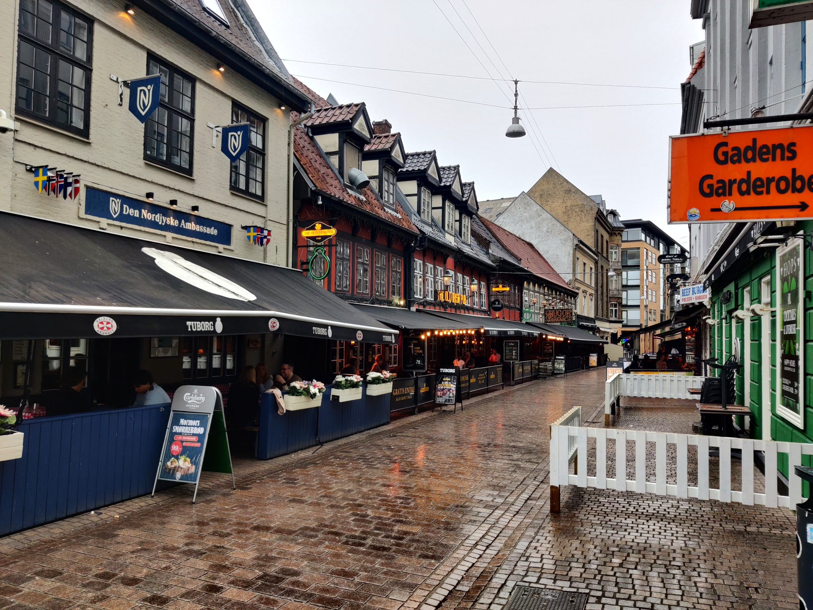

## DK Týden 08: Jomfru Ane Gade, Aalborg

V Aalborgu jsem přespával v malém hotelu v ulici "Panny Anny" a byl jsem skutečně v centru dění. Ubytování nebylo drahé a já až na místě pochopil příčinu - ulička žije bohatým nočním životem, bez špuntů do uší se tu moc nevyspíte. Není neobvyklé, že ve tři hodiny ráno si maník na ulici přinese bednu Marshall, připojí elektrickou kytaru a hraje tak nahlas, aby to nikomu v ulici neušlo.

Dvě noci jsem tu přečkal a večer mohl nasávat atmosféru této legendární uličky. Pokud hledáte jídlo nebo pití, zde najdete snad všechny světové kuchyně a barové styly.

<https://en.wikipedia.org/wiki/Jomfru_Ane_Gade>

<https://www.tv2nord.dk/aalborg/sadan-bliver-j-dag-i-gaden>

---

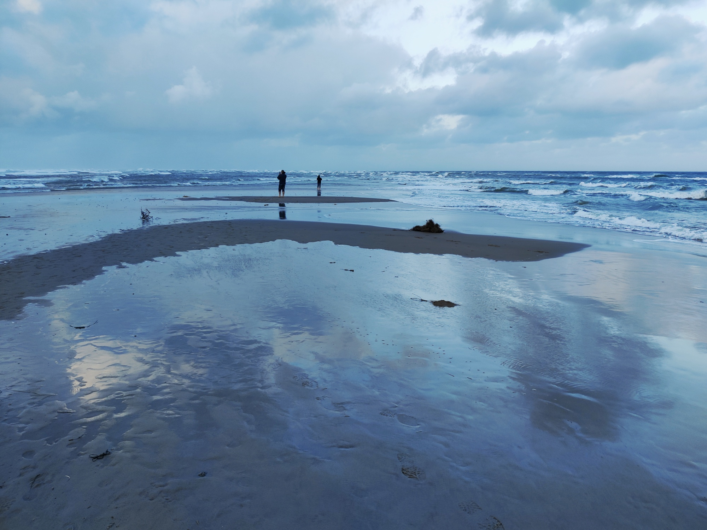
## DK Týden 09: Skagen Odde

Toto geograficky zajímavé místo jsem při minulé návštěvě Dánska vynechal, tak jsem to musel napravit: stýkají se tu Severní moře (průliv Skagerrak) a Baltské moře (průliv Kattegat). Obě moře mají různou teplotu, salinitu a hustotu a na mysu Grenen je občas vidět jejich rozdílná barva  - tu na mé fotce nevidíte. Skoro vždy však můžete pozorovat dva příboje, jak do sebe zuřivě naráží - Skagerrak ze severu a Kattegat z jihovýchodu. Vlastní mys se díky sedimentům posunuje přibližně o šest metrů každým rokem a postupně tak zužuje průliv Kattegat. Je to jedno z míst, kde fotografie nedokáže plně zachytit atmosféru - sílu živlů, barvy moří, hluk příboje. Vlny do sebe narážejí s takovou zuřivostí, jakoby věděly, že v příštích sekundách se jejich energie eliminuje, a tak se aspoň naposledy předvedou.

Z fotografie je vidět, že nebylo ideální počasí, poprchávalo a byl silný vítr. Na konci cesty se mraky aspoň trošku protrhly, to byla dostatečná odměna za 1500m dlouhou procházku pískem, mokré boty i nohavice.

Okolí mysu obývá významná kolonie tuleňů a mnoho druhů ptáků.

Pár kilometrů podél Kattegat se nachází druhý nejvyšší dánský maják Skagen Fyr, pod kterým se dá pěkně vyspat v autě. Odtud mám jen méně kvalitní noční fotky a videa, sem se nedostaly.

<https://en.wikipedia.org/wiki/Grenen>

<https://www.embark.org/denmark/activity-type/adventures/grenen-skagen>

<https://www.enjoynordjylland.com/north-jutland/plan-your-trip/grenen-skagen-gdk640520>

<https://detgraafyr.dk/english>

---

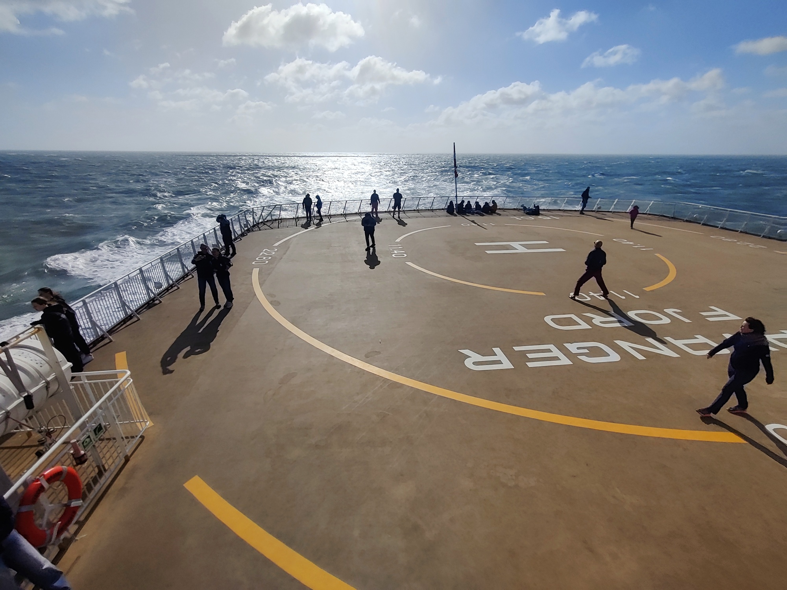
## DK Týden 10: Trajekt do NO

Z dánského přístavu Hirsthals jsem se plavil trajektem do norského Kristiansandu. Jeli jsme lodí MS Stavangerfjord a už před vyplutím to maličko zavánělo dobrodružstvím - kvůli předpovědi počasí v Skagerraku bylo vyplutí posunuto na dřívější hodinu, počasí se mělo postupně zhoršovat a později už by to mohlo být méně bezpečné či méně pohodlné. To jsem přivítal, protože jsem si přál zjistit, jak to mám s mořskou nemocí. Teď už mám jasno...

Veliká loď ovšem skýtá dostatek komfortu a jen velké vlny ji mohou rozhoupat tak, že se voda převaluje přes příď na šesté palubě z deseti. To nám bylo dopřáno zažít. Fotky z toho nemám, protože se přes okna moc fotit nedalo. Místo toho sem dávám fotografii ze zádi, když byly vlny ještě mírnější a spousta pasažérů si spolu se mnou šla užívat větru a sluníčka. Houpání paluby není na fotce vidět, ale bylo zřetelné, jako suchozemec jsem si musel zvyknout na úplně jiný styl chůze. Špatně od žaludku mi však nebylo...

<https://fjordline.com/en/p/our-ships/ms-stavangerfjord/about-the-ship>

<https://en.wikipedia.org/wiki/MS_Stavangerfjord_(2012)>

---

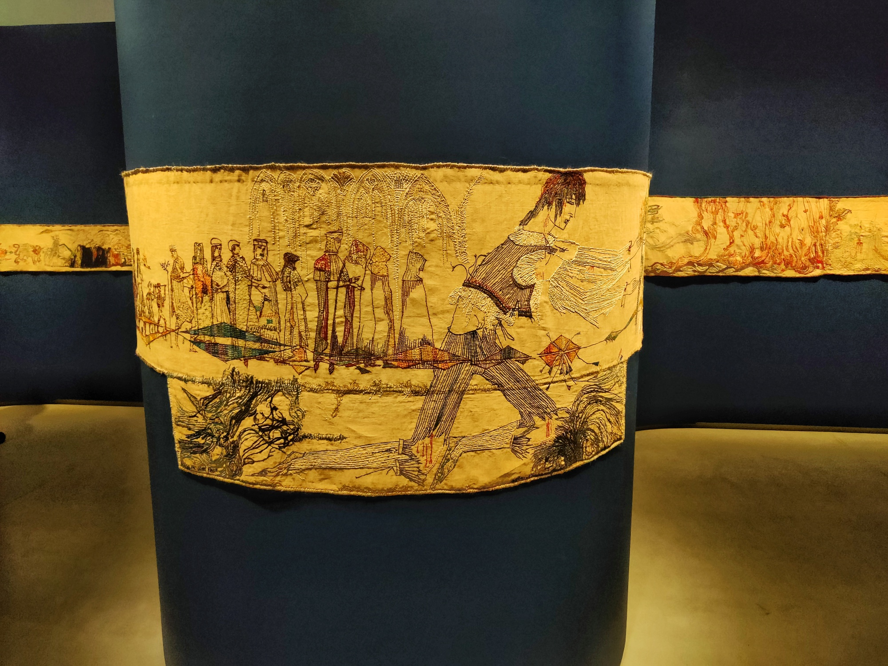
## NO Týden 11: Draumkvedet by Torvald Moseid (Kunstsilo)

Padesét pět metrů dlouhé vyšívané dílo, na kterém pracoval Torvald Moseid čtrnáct let a byl to jeho poslední monumentální počin. Zvolil jsem ho jako reprezentativní (a velice zajímavý) umělecký objekt umístěný ve slavném Kunstsilu.

Jak jsem se do Kunstsila dostal? Na podzim roku 2024 jsem s velkým zájmem sledoval video Adama Gebriana (@agebrian) o fascinujícím přerodu průmyslové stavby na muzeum. Do paměti se mi ale nezapsalo jméno norského města (Kristiansand).

Když jsem loni v létě přijížděl trajektem do přístavu v Kristiansandu, zpozoroval jsem už z lodi tuto bílou dominantu. Ihned jsem se rozhodl prodloužit si tam ubytování a jeden den navíc strávit na ostrově Odderøya. Architektonicky zajímavé a nádherné umělecké centrum Kilden bylo bohužel uzavřené (nechávám si ho na příště), ale Kunstsilo jsem si užil maximálně. Když si zaplatíte vstupné, můžete projít všechna patra s uměním. Velmi dlouhá výšivka nebyla jedinou zajímavostí. Jinou instalaci považuji za nejlepší zážitek v Kunstsilu, nešlo ji však fotografovat, napíšu vám o ní příště.

Zatím si můžete pustit skvělé video Adama Gebriana, musím vás však varovat - získáte pravděpodobně neodolatelnou touhu toto norské město navštívit.

<https://www.youtube.com/watch?v=XWMtkU8ffFU>

<https://www.kunstsilo.no/en/exhibitions/draumkvedet>

<https://www.instagram.com/p/DUblJvaCGlQ/>

<https://no.wikipedia.org/wiki/Torvald_Moseid>

<https://www.kunstsilo.no/en>

<https://www.theguardian.com/artanddesign/article/2024/may/16/kunstsilo-grain-silo-gallery-kristiansand-norway-trillion-dollar-man>

---

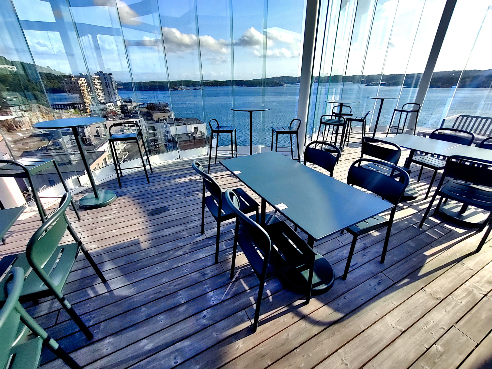
## NO Týden 12: Brasserie, Kunstsilo

Ještě jeden týden se budu věnovat Kunstsilu v Kristiansandu. Nahoře nad původní stavbou sila byla vybudována prosvětlená "Brasseri", kde si můžete dát kávu nebo oběd. Pokud máte pěkné počasí (jako já), budete se pravděpodobně chtít posadit do prosklených výklenků, odkud je z výšky 38 metrů vidět na velkou část ostrova Odderøya nebo na přístav a hlavní čtvrti města. Je tam příjemně čerstvý vzduch, protože jednotlivé skleněné pruhy mají mezi sebou mezery. Celkový dojem připomíná vrchol majákové věže, místo, ze kterého proudí světlo.

Z minulého týdne jsem si nechal popis umělecké instalace, která mne velmi překvapila, a možná i proto ohromně zaujala: "VOX by Jónsi". Jestli znáte islandskou hudební skupinu Sigur Rós, tak budete znát i jméno Jónsi. Jón Þór "Jónsi" Birgisson vytvořil audiovizuální instalaci, ve které hraje hlavní roli jeho hlas, reprodukovaný z padesáti reproduktorů kolem místnosti. Váš zážitek je zesílen optickými vjemy, které jsou docela prosté - až minimalistické - svým designem, ale silné účinkem: působivé barvy zobrazované na vodorovných pásech ze všech stran místnosti. Pokud posloucháte sami - nebo skoro sami - máte velmi hluboký prožitek: temná místnost, občasné světlo, barvy kolem vás, Jónsiho hlas všude kolem vás.

Slovy to nedokážu dobře popsat, zkuste si pustit nějaké krátké video uvedené dole. Nebo pátrejte po tom, kde je instalace VOX v současnosti v provozu, v Kristiansandu už to není.

<https://www.kunstsilo.no/en/visit-us/brasserie>

<https://www.dezeen.com/2024/05/09/kunstsilo-museum-grain-silo-norway/>

<https://en.wikipedia.org/wiki/Odder%C3%B8ya>

<https://martynwhite.co.uk/art/jnsis-vox-at-kunstsilo-where-voice-becomes-light-sound-and-spirit>

<https://www.kunstsilo.no/en/exhibitions/vox-av-jonsi>

<https://www.kunstsilo.no/en/channel/interview-w-jonsi>

<https://www.kunstsilo.no/no/kunstsilo-live/utstillingsapning-vox-av-jonsi>

<https://www.youtube.com/watch?v=yPVdDxYTZyQ>

<https://vimeo.com/885991712>

---

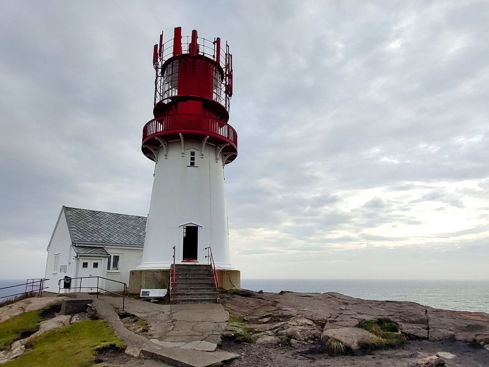

## NO Týden 13: Lindesnes fyr

První den opravdového auto-výletu po Norsku jsem věnoval jižnímu pobřeží. Navštívil jsem známou pláž Kanelstranda, tu však musíte vidět kolem západu slunce za pěkného počasí, abyste ulovili legendární snímky (a to nebyl můj případ).

Další zastávkou byl velice známý maják "Lindesnes fyr" se zajímavou historií i technickým dědictvím. Bez zaplacení vstupného se nedostanete ani k majáku, tak jsem zaplatil. Vyplatilo se to, v ceně byl i přístup ke zbytkům WWII opevnění a vstup do pěkného muzea. Původní zdroje světa, historické Fresnelovy čočky, to jsou příklady exponátů.

Na noc jsem odjel na první mé "divoké" norské parkoviště u jezera Botnevatnet na silnici Kvanvikveien. Bylo tak plno, že jsem tam skoro nezaparkoval, ale nakonec se v autě vyspal slušně, pravděpodobně díky únavě.

<https://www.visitnorway.com/listings/kanelstranda-cinnamon-beach/17598/>

<https://en.wikipedia.org/wiki/Lindesnes_Lighthouse>

---

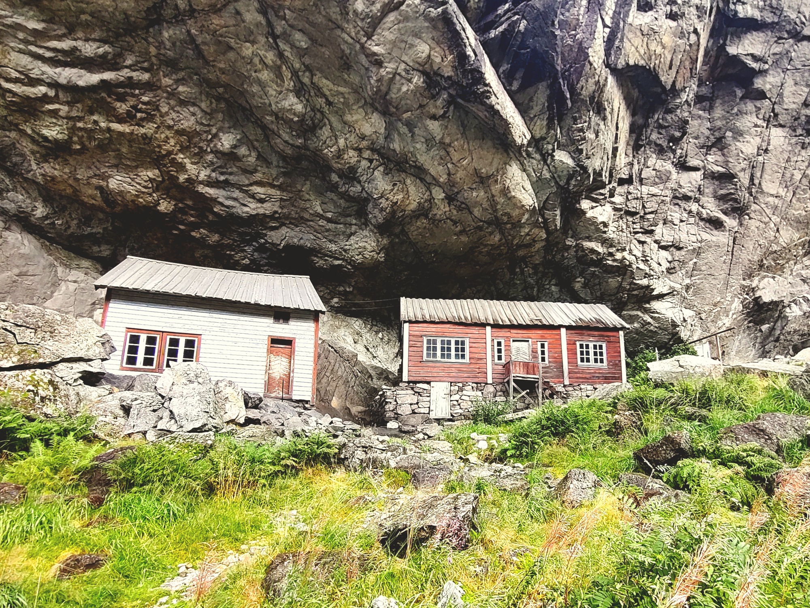

## NO Týden 14: Helleren, Jøssingfjord

Další den jsem brzo ráno vyrazil do Jøssingfjordu za jednou z nejslavnějších atrakcí - národní památkou Helleren. Dva domky byly postaveny pod skalním převisem hlubokým přibližně deset metrů, který je částečně chrání před deštěm a sněhem. Zřejmě již od sedmnáctého století bylo možné toto místo celoročně obývat - viz odkazy níže.

Opodál je postavená zajímavá moderní stavba: vědecké muzeum Jøssingfjordu. Byl jsem na místě příliš brzo a nechtělo se mi čekat na otevírací hodinu (11:00), tak jsem návštěvu muzea vynechal. Podle toho, co se dá přečíst na webu nebo informačních tabulích, ta návštěva by stála za to.

Místo toho jsem se zastavil na vrcholu skály nad převisem, je tam parkoviště, pěkný výhled a přístup k historickému památníku postavenému na počest norských hrdinů, kteří vzdorovali nacistické okupaci.

<https://dalanefolkemuseum.no/avdelinger/helleren/>

<https://dalanefolkemuseum.no/avdelinger/jossingfjord-vitenmuseum/>

<https://www.visitnorway.com/listings/helleren-and-jossingfjord/25192/>

<https://en.wikipedia.org/wiki/J%C3%B8ssingfjord>

---

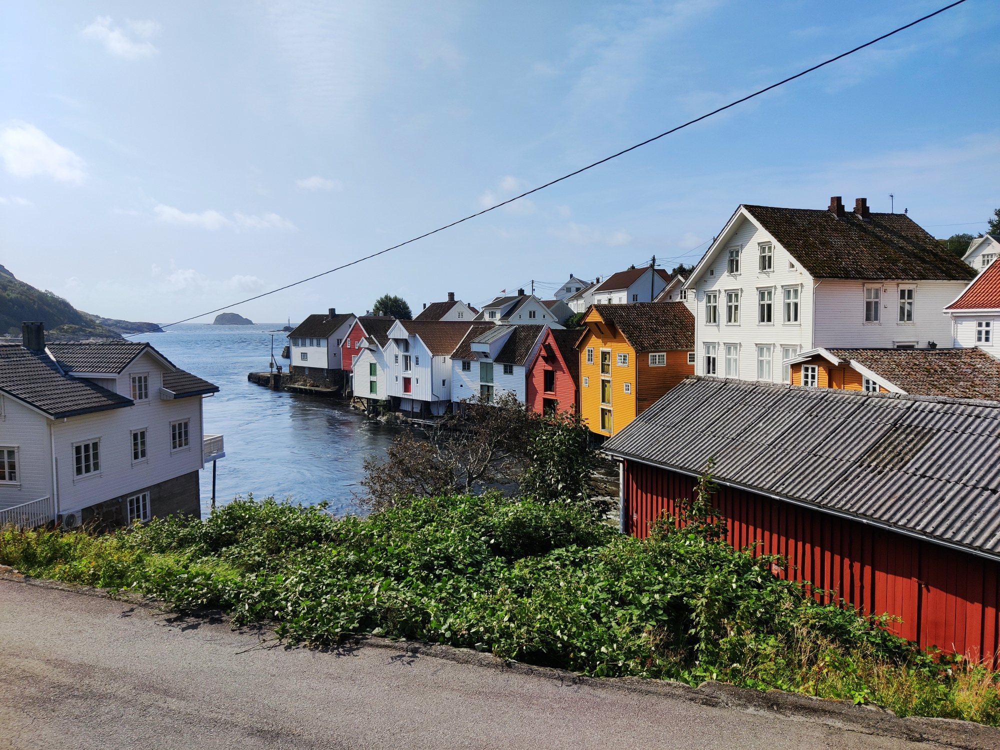

## NO Týden 15: Sogndalstrand

Přístavní vesnice Sogndalstrand (Sogndalsstranda) byla postavena kolem ústí řeky Sokno do Severního moře. Dodnes jsou tam zachovány malebné domy na nábřeží, dříve sloužily často jako sklady dovezeného zboží. Z druhé strany těchto domů prochází ulice Strandgaten - pokud půjdete na její jižní konec a pak vystoupáte do výšky, dostanete se až k vyhlídce na moře (Loshytto).

Na druhém břehu řeky můžete dojít až do přístavu, který se dnes už neužívá k dovozu zboží.

<https://en.wikipedia.org/wiki/Sogndalstrand>

<https://www.visitnorway.com/listings/sogndalstrand/25196/>

<https://www.fjordnorway.com/en/attractions/sogndalstrand>

<https://magmageopark.no/en/location-object/sogndalstrand/>

---

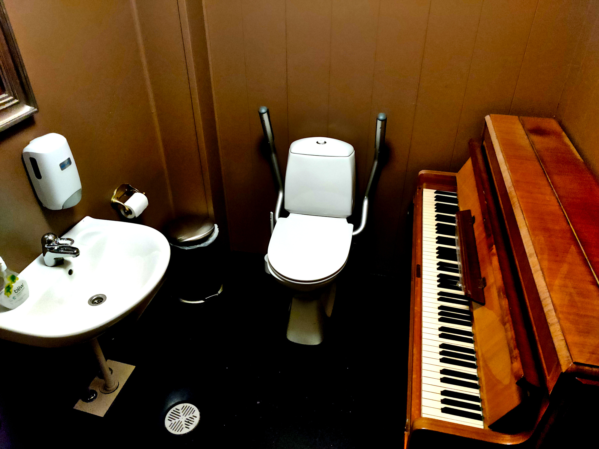

## NO Týden 16: Sogndalstrand Kulturhotell

Významnou budovou na Strandgaten (Sogndalstrand) je Kulturhotell; zaujal mne už zvenku, tak jsem se rozhodl dát si tam kávu. Pěkné prostředí jejich jídelny jsem sice vyfotil, ale nakonec je nejlepším snímkem tato toaleta s funkčním piánem - a bylo docela dobře naladěné, pokud mohu posoudit.

<https://sogndalstrand-kulturhotell.no/en/home/>

<https://www.visitnorway.com/listings//sogndalstrand-kulturhotell/25108/>

---

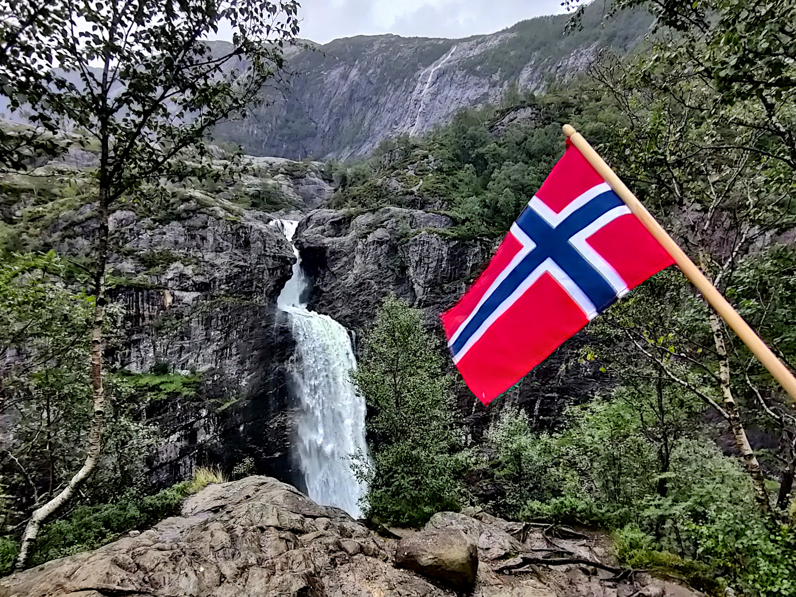

## NO Týden 17: Månafossen

Byla to moje vlajka? Nebyla. Musel jsem kvůli vyhlídce na vodopád lézt po skále? Musel (viz YT video v odkazech).

Z parkoviště je cesta asi 100 výškových metrů nahoru k vyhlídce. Naštěstí je cesta dobře připravená, snad jen za vlhka by byla nebezpečná.
Nicméně klasifikace obtížnosti norských pěších tras je asi trochu jiná, tohle bylo myslím označeno jako "lehké". Rozhodně nedoporučuji se nahoru vydat bez dobrých pevných bot.

Nahoru a dolů proudily skupinky turistů, na místě byl však klid a mohli jste si najít místo jen pro sebe. Já se tam seznámil s norskou rodinou, rodiče a dvě menší děti. Napadla mne otázka o cestování po rodné zemi: "Jak často se vydáte k nějaké turistické atrakci (skála, výhled, vodopád), když se nachází ve vaší zemi?" Norové mi odpověděli, že u tohoto vodopádu jsou poprvé v životě a že v posledních letech cestují víc, protože děti toho už jsou schopny (úplná klasika, tak to má IMO i většina našich rodin). Smalltalk nemá cenu sdílet, ale musím jim ještě jednou poděkovat za půjčení vlaječky, kterou se mi podařilo docela dobře použít v mé fotografii (viz "hloubka ostrosti").

Cesta dolů byla nepřekvapivě náročnější, i proto, že začalo drobně mžít.

Pokud budete někdy v okolí Stavangeru, rozhodně doporučuji!

<https://en.wikipedia.org/wiki/M%C3%A5nafossen>

<https://www.visitnorway.com/listings/manafossen-waterfall-and-friluftsgarden-man/39557/>

<https://www.youtube.com/watch?v=WmBoDCR5hbs>

---

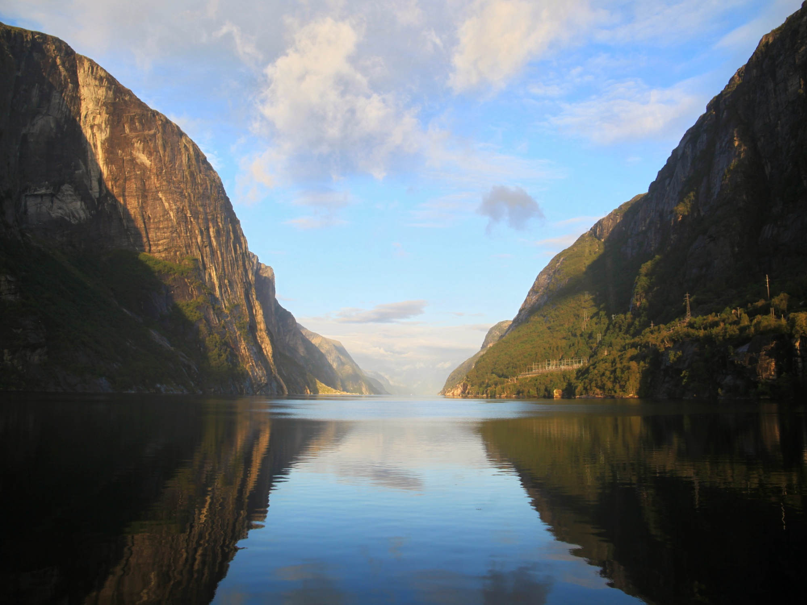

## NO Týden 18: Lysefjord from Lysebotn

Foceno 11. 8. 2025 před sedmou hodinou z kempu v Lysebotn. Den předtím jsem dorazil autem po silnici 4224 (Lysevegen) se slavnými serpentinami a dokonce jednou otočkou uprostřed kopce (Lysetunnelen), ve které cesta klesne na 1103 metrech o cca 100 metrů. Bylo špatné počasí, fotit nemělo moc smysl.

Nahoře nad serpentinami se nachází odpočívadlo a vyhlídka Øygardsstølen, tam jsem se zastavil a dal si kafe. Je jasné, že za krásného počasí tam jsou moc pěkné výhledy, já pár fotek dal už dříve do příspěvku označeného "Kjerag". S obsluhou občerstvení jsem prohodil pár slov, ukázalo se, že provozují také kemp dole v Lysebotn, kam jsem měl namířeno.

Výlet lodí do Flørli (Flørlitrappene) je zdokumentován v jiném příspěvku, viz níže.

<https://www.visitnorway.com/places-to-go/fjord-norway/the-stavanger-region/listings-stavanger/lysevegen-road-in-lysebotn/235453/>

<https://linktr.ee/kjeragcaferestaurant>

[Flørli](https://www.instagram.com/p/DNvAzkXVIuG/)

[Kjerag](https://www.instagram.com/p/DNsSpIkVCMK/)

---

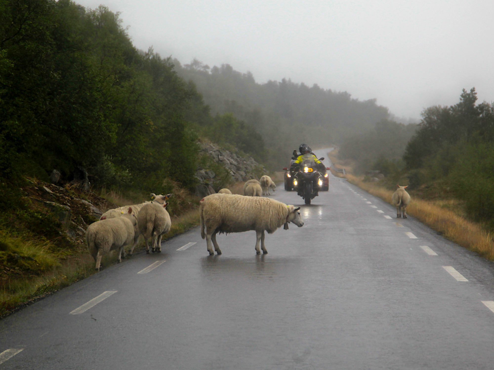

## NO Týden 19: Vardsvatn - Kvislevassknuten trekksone

Chráněná horská oblast, přes kterou jsem jen projížděl autem za mlhavého počasí. Podle informací v turistických průvodcích se zde dají naplánovat pěkné túry.

S ovečkami jsem se setkal několikrát, tohle byl tak malebný záběr, že jsem ho z auta vyfotil. Ovce (i jiná zvířata) volně procházejí krajinou, podle zdrojů je každé léto do divočiny vypuštěno přibližně dva miliony ovcí. My naštěstí nepotkali velké stěhování, kdy ohromná stáda jdou krajinou silnice nesilnice...
Pár oveček na cestě, to je docela příjemný, i když trochu omezující zážitek. Dopravní značky upozorňují na místa s nejfrekventovanějším výskytem těchto sudokopytníků. Dopravní značka je něco jako první varování, další úroveň pozornosti musíte zapnout, když uvidíte první ovečku: to znamená, že budou určitě poblíž i další a na silnici se doporučuje ještě o něco snížit rychlost, třeba i na 30 km/h. Tak se vyhnete nepříjemnostem.
No a když se ovce na silnici zastaví a vypadá to, že neví, co dál? Prý vždy vědí, kde jsou a kam mají namířeno, jen prostě žijí svůj život pomalejším tempem než my, motoristé nebo cyklisté. Nakonec vždycky odejdou, kam potřebují, na silnici si obvykle nelehají..

Šťastné putování po norských silnicích!

<https://www.visitnorway.com/places-to-go/fjord-norway/happy-sheep/>

<https://www.komoot.com/cs-cz/guide/159972/turistika-kolem-setesdal-vesthei-ryfylkeheiane-landskapsvernomrade>

<https://peakvisor.com/peak/kvislevassnuten.html>

<https://www.gaiagps.com/hike/norway/aust-agder/vardsvatn-kvislevassknuten-trekksone/>

---

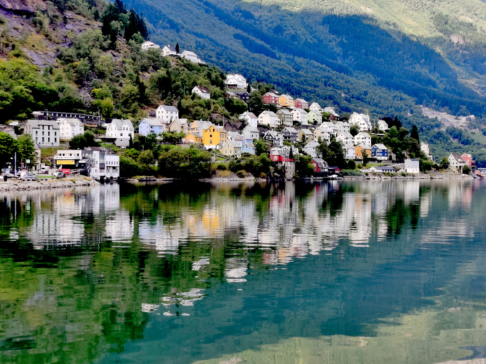

## NO Týden 20: Odda

Ve středu 13. 8. 2025 jsem měl na programu dlouhou cestu z Røldal až do Bergenu. Byly naplánovány návštěvy několika vodopádů, ale hned ten první - Låtefossen - byl tak obležen turisty s karavany, že jsem zastávku vzdal. V ušetřeném čase jsem strávil hodinu v pěkném městečku Odda - později jsem si přečetl v bedekrech, že je považováno za jedno z nejmalebnějších míst v západním Norsku.

Zaparkoval jsem u nábřeží a šel se aspoň zvenku podívat na pěkný - úplně bílý - kostel Odda Kirke. Přes vodní hladinu jsem vyfotil protější svah s barevnými domky a nakoupil nějaké oblečení na pěší zóně v ulici Røldalsvegen (měli velké slevy!).

V okolí městečka Odda byl natáčen fantasy seriál Ragnarök (Netflix, tři sezóny, 18 epizod).

<https://en.wikipedia.org/wiki/Odda_(town)>

<https://www.facebook.com/pages/Odda/280964478751724/>

<https://nordivatours.com/things-to-do-in-odda-norway/>

<https://www.imdb.com/title/tt9251798/>

<https://www.csfd.cz/film/794655-ragnarok-konec-sveta/prehled/>

---

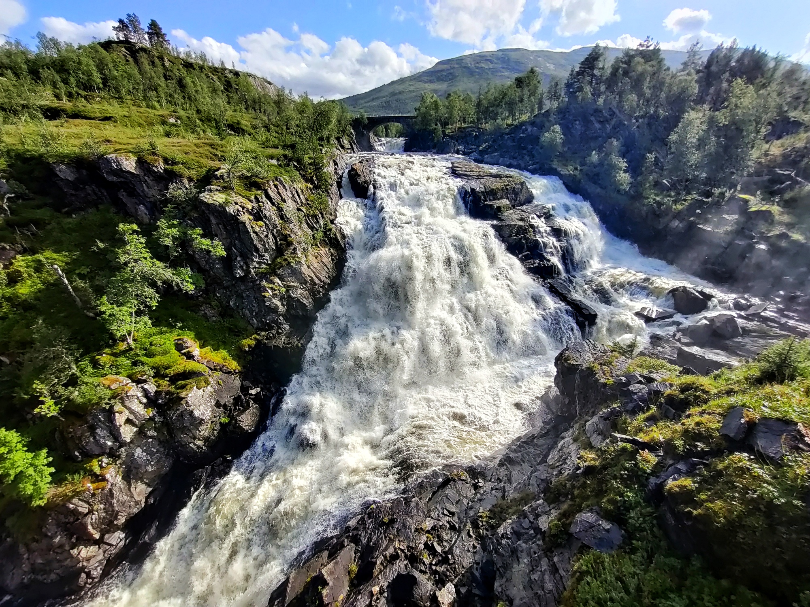

## NO Týden 21: Fossatromma

Z Oddy jsem se vydal do Trolldalen za skupinou velmi populárních vodopádů. Fossatromma na fotce je první z nich, následuje Vøringfossen (nad ním se můžete projít po pěkné lávce) a zboku se připojuje Tysvikjofossen. Zázemí pro turisty je tam vynikající, odhadl jsem, že nahoře (větší koncentrace parkovišť a restaurací) bude moc rušno, tak jsem zastavil na dolní plošině. Odměnou mi byla procházka po chodníčkách kolem bažiny, několik vyhlídek na vodopády a nakonec přístup na již zmíněnou lávku. Prošel jsem se, vyfotil spoustu snímků a odjížděl spokojen.

Na cestě z Trolldalen do Måbødalen (tam jsem pro nedostatek času vynechal /jistě pěkné/ muzeum - viz odkaz) se silnice noří do čtyř tunelů, které dokonce tvoří smyčky (viz mapa na norské Wikipedii).

Ale největší silniční atrakce mne teprve čekaly: most Hardangerbrua (nejdelší visutý most v zemi a třetí nejdelší v Evropě) a potom legendární 7510m dlouhý tunel Vallaviktunnelen, na kterém byl později postaven kruhový objezd a propojka na Hardangerbrua. Pokud někde na internetu uvidíte fotku kruháče v podzemí, pravděpodobně to bude on.

<https://hardangerfjord.com/eidfjord/opplevelser/fin-rundtur-ved-voringsfossen-6368183>

<https://hardangerfjord.com/eidfjord/opplevelser/voringsfossen-1571743>

<https://no.wikipedia.org/wiki/Storegjeltunnelen>

<https://hardangerfjord.com/eidfjord/opplevelser/mabodalen-kulturlandskapsmuseum-919753>

<https://nn.wikipedia.org/wiki/Hardangerbrua>

<https://en.wikipedia.org/wiki/Vallavik_Tunnel>

---

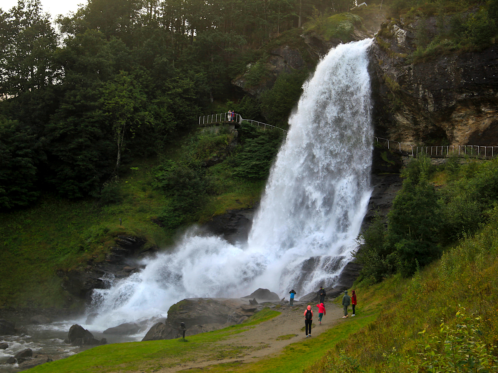

## NO Týden 22: Steinsdalsfossen

Ten den jsem musel dojet do Bergenu, ale nemohl jsem vynechat jeden z nejzajímavějších vodopádů mé cesty - Steinsdalsfossen. Z těch, která jsem v Norsku navštívil, to byl jediný, kde se dalo zajít za padající vodu a získat tak jedinečný zážitek (o tom však až příští týden).

Na obrázku je vidět pohled zdola - voda padá s takovou silou, že vás mrholení zmáčí na desítky metrů daleko od paty vodopádu. Já s sebou neměl nepromokavý oděv, tak jsem se tolik nepřiblížil.

<https://www.visitnorway.com/listings/steinsdalsfossen-waterfall/14039/>

<https://en.wikipedia.org/wiki/Steinsdalsfossen>

<https://en.wikipedia.org/wiki/List_of_waterfalls#Norway>

---

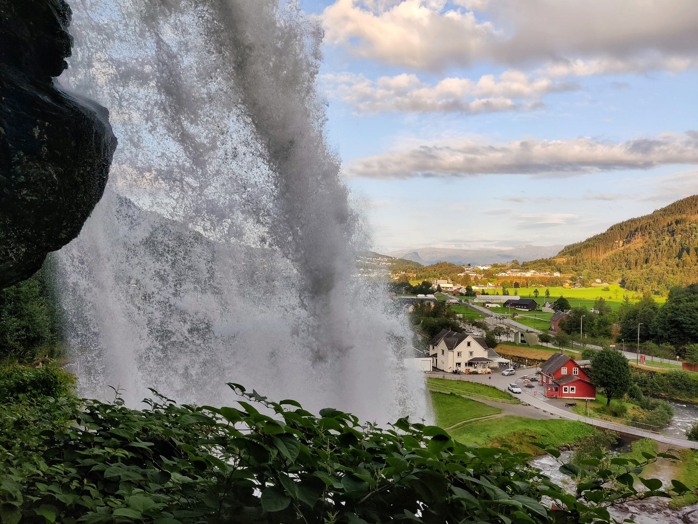

## NO Týden 23: Øvsthus

Druhá fotografie vodopádu Steinsdalsfossen ukazuje pohled zpoza padající vody na obec Øvsthus, na jejímž území se vodopád nachází. Pohodlnou cestičkou se dostanete až za vodopád a můžete si užívat jedinečný zážitek nebo fotit na krátké či dlouhé časy proud vody. Já si zvolil 1/700 sekundy pro zachycení jednotlivých kapek.

Protože jsem tam byl navečer a slunce se již klonilo k západu, osvětlovalo krajinu pěkným teplým světlem. Další výhodou pozdní návštěvy byla absence velkého množství turistů. Do nedalekého Bergenu jsem dojel ještě za světla, tomu se však budu věnovat později.

<https://www.visitnorway.com/listings/steinsdalsfossen-waterfall/14039/>

<https://en.wikipedia.org/wiki/Steinsdalsfossen>

<https://en.wikipedia.org/wiki/List_of_waterfalls#Norway>

---

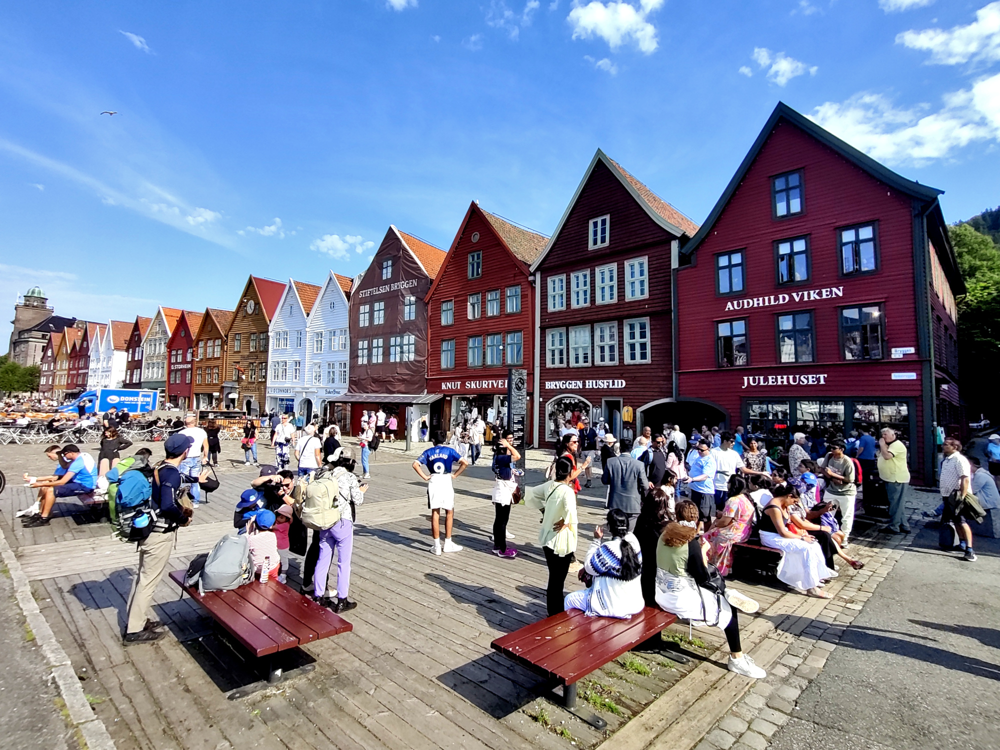

## NO Týden 24: Bryggen

V Bergenu jsem strávil jeden celý den. Původní plán vyjet lanovkou Fløibanen nad město padl, protože bylo krásné počasí, turistů velmi mnoho a fronta na lístky byla snad sto metrů dlouhá. Místo toho jsem se procházel po nábřeží, hlavně slavnou čtvrtí Bryggen, chráněnou UNESCO. Kromě úzkých uliček a zajímavých starých domků mne zlákala místní kuchyně - chtěl jsem ochutnat rybí polévku, tak jsem se zeptal AI a na její radu zašel do ne příliš drahé hospůdky na "Bergensk fiskesuppe med laks" (více obrázků najdete ve starším Ig postu, odkaz je uveden dole).

V Bergenu na nábřeží jsem rovněž zašel na zlevněné suvenýry a koupil pár dárků a pro sebe např. norskou vlaječku a tričko s nápisem "Troll". Pokud mne v něm uvidíte, můžete si vzpomenout na Bergen.

<https://en.wikipedia.org/wiki/Bryggen>

<https://en.wikipedia.org/wiki/Bergen>

<https://snl.no/Bryggen_i_Bergen>

<https://scandinaviancookbook.com/fiskesuppe-creamy-norwegian-fish-soup/>

<https://www.instagram.com/p/DOV1S6kCqJl/>

---

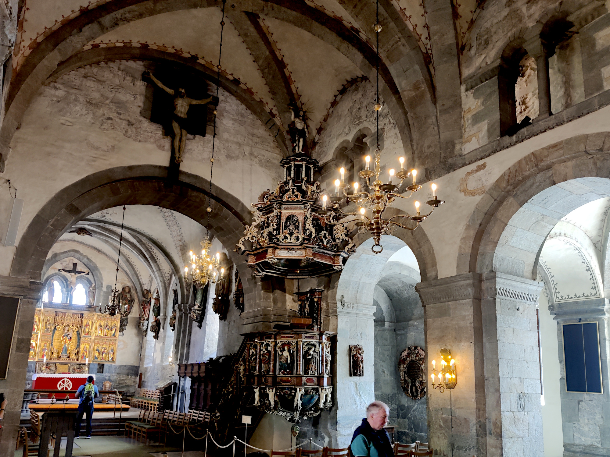

## NO Týden 25: Mariakirken, Bergen

Při procházce přístavem a okolím jsem narazil na anglikánský kostel Mariakirken v Bergenu. Byla možnost vyhnout se placení vstupného v době pravidelných krátkých bohoslužeb/motliteb. Tak jsem se rozhodl zúčastnit se a spojit příjemné s užitečným. A byl to dobrý nápad, sloužila sympatická reverendka, která si všimla, že většinou poslouchají turisté, tak ihned přepnula do angličtiny a pouze jednu nebo dvě modlitby nechala v norštině.

Bylo to velmi příjemné a já jsem pak zašel reverendce poděkovat a prohodit pár slov - aby věděla, že její slova mají zásah až do ČR. Kostel má interiér v pěkném stavu, vybrat foto do kalendáře bylo těžké.

<https://www.bergenanglicans.net/>

<https://en.wikipedia.org/wiki/Bergen_Anglican_Church>

---

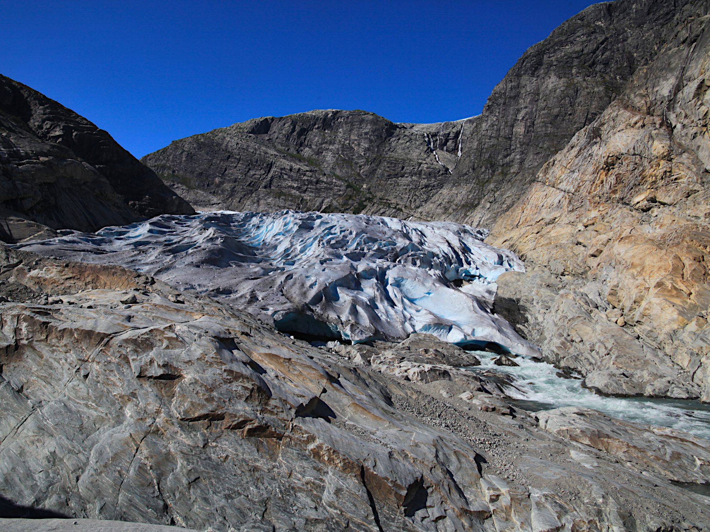

## NO Týden 26: Nigardsbreen

V polovině srpna jsem několik dnů věnoval ledovcům, zejména největšímu evropskému pevninskému ledovci Jostedalsbreen. 

Bydlel jsem v Førde a nejprve jsem si zajel do muzea Norsk BreMuseum. Moc pěkná expozice je korunována úchvatným širokoúhlým filmem s vysokým rozlišením, který si můžete zhlédnout i vícekrát během vaší návštěvy muzea. Já ho viděl dvakrát a navíc i dokument o vzniku tohoto jedinečného díla. 

Zvuk přicházející ze všech stran a obraz šířky 15K pixelů (poměr stran je 5:1) vás úplně vtáhnou do nádherného světa ledovce Jostedal. Film byl natočen místní produkční společností Falkeblikk a abyste ho viděli, musíte navštívit muzeum (prý ho nikdy neposkytnou k projekci mimo muzeum). Teaser je uveden dole v odkazech (a věřte mi, vlastní film je ještě mnohem působivější). 

Fotografie z kalendáře ukazuje jedno z nejznámějších míst ledovce Jostedal - ledovcový splaz Nigardsbreen. Můžete přijet autem na parkoviště vzdálené pár kilometrů od vlastního ledovce, nahoru se ale musíte vydat pěšky. Je to přes 2 km daleko s převýšením kolem 150 m. Za pěkného počasí neustále vidíte cíl cesty a máte motivaci pokračovat, i když cesta trvá skoro hodinu.

<https://www.instagram.com/p/DQVKjWGipow>

<https://www.falkeblikk.no/en/panoramicmovies/>

<https://youtu.be/pybGLEs6pGk>

<https://en.wikipedia.org/wiki/Nigardsbreen>

<https://www.jostedal.com/>

<https://www.jostedal.com/nigardsbreen/>

<https://www.visitnorway.com/listings/nigardsbreen-glacier/111298/>

<https://www.bremuseum.no/>

---

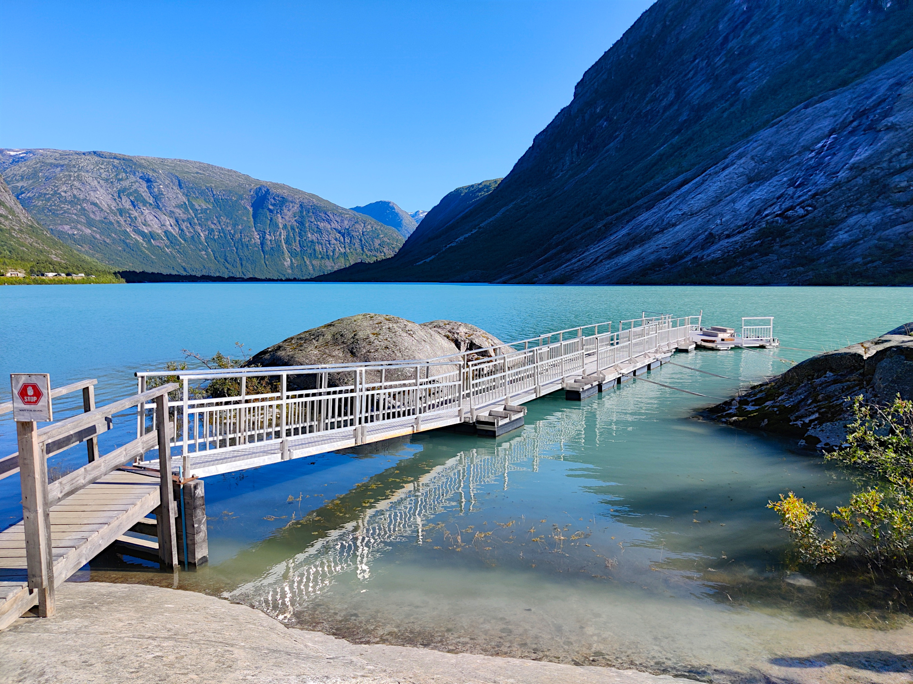

## NO Týden 27: Nigardsbrevatnet

Když jsem se přibližoval pěšky k Nigardsbreen, zjistil jsem, že nejotravnější a nejnáročnější část cesty je překvapivě po rovině kolem jezera Nigardsbrevatnet. Neměl jsem mnoho času, tak jsem se vrátil k molu a zaplatil si cestu malou motorovou lodí, která ušetří čas a nabídne krásné výhledy na ledovec z hladiny jezera. Cestou zpět jsem musel chvátat, abych stihl poslední plavbu zpátky.

Všimněte si barvy ledovcové vody, modrou mléčnou barvu má i říčka Breelvi, která z jezera (a ledovce) vodu odvádí. Viz úplně poslední stránku kalendáře.

<https://no.wikipedia.org/wiki/Nigardsbrevatnet>

<https://www.visitnorway.com/listings/kayaking-on-nigardsbrevatnet-and-hike-on-nigards-glacier/237509/>

<https://www.komoot.com/guide/184242/hiking-around-nigardsbrevatnet>

---

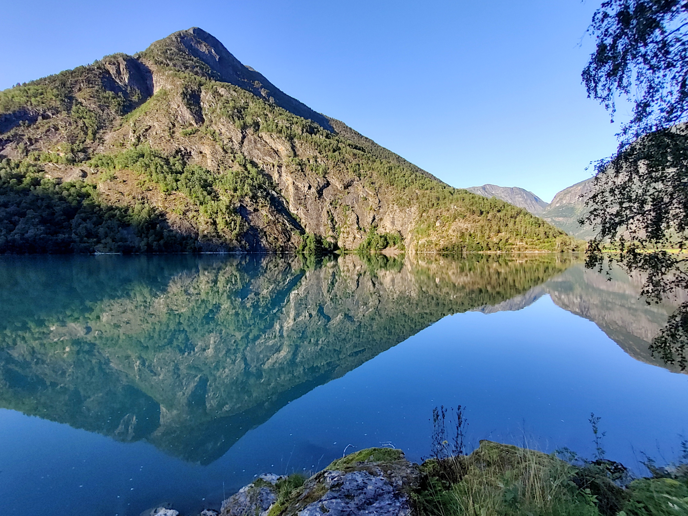

## NO Týden 28: Eidsvatnet, Ludwig Wittgenstein hut

**Ludwig Wittgenstein (1889–1951)**, rakouský filozof a jedna z největších osobností myšlení 20. století, zásadně proměnil způsob, jakým filozofie uvažuje o jazyce. Zajímal ho vztah mezi tím, co si myslíme, jak o tom mluvíme, a světem, který se tím snažíme popsat. Část svého slavného *Tractatu logico-philosophicus* napsal právě zde, ve Skjoldenu v západním Norsku, v domku nad jezerem Eidsvatnet, kam se opakovaně vracel. V tamní krajině nacházel ticho, odstup a klid potřebný k přemýšlení i psaní.

Pozn.: domek je na této širokoúhlé fotografii dost maličký, ale s trochou úsilí ho jistě najdete.

<https://www.stiftinga-wittgenstein.no/en/huset>

<https://www.visitnorway.com/listings/osterike-the-site-of-wittgensteins-hut-in-skjolden/245704/>

<https://upnorway.com/inspiration/wittgenstein-in-norway-a-philosophical-journey>

---

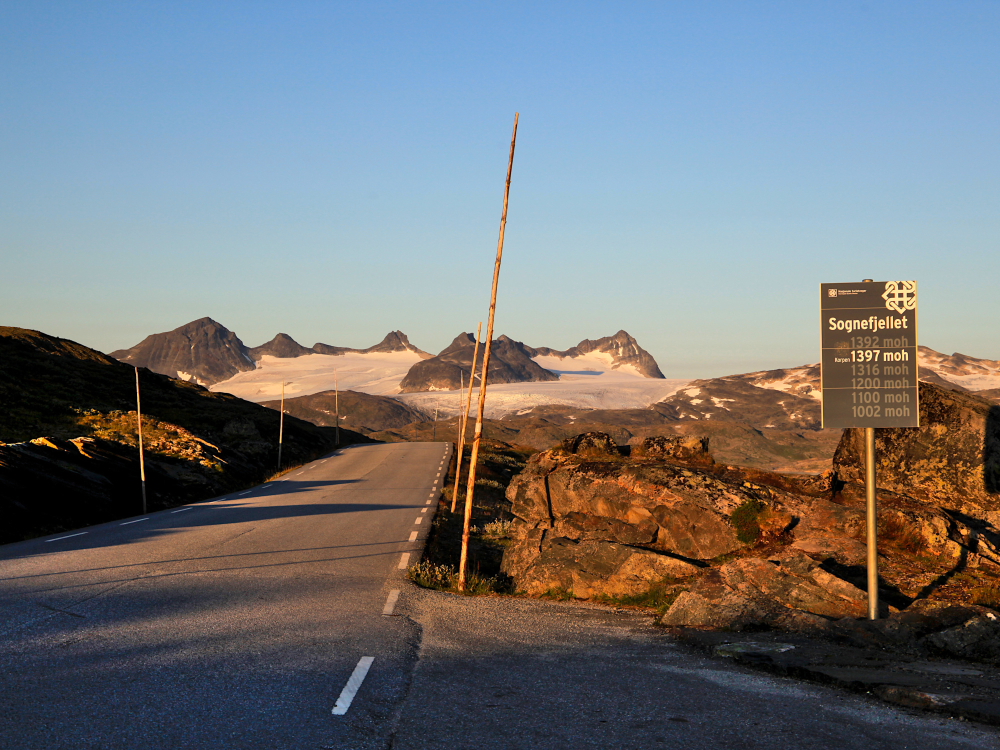

## NO Týden 29: Sognefjellet

Cestu z Førde do Lom jsem si naplánoval přes hornatou oblast / průsmyk **Sognefjellet**. Vede tam velmi slavná silnice, postupně až k nadmořské výšce 1430 m. Pokud jste někdy viděli video, jak se na jaře v Norsku frézuje průjezd závějemi vysokými několik metrů, mohlo to být právě na této silnici.

Já jsem ovšem projížděl v létě, tak jsem si užil pěkných výhledů na okolní hory. Zastavil jsem několikrát, tato fotografie je z odpočívadla v nejvyšším bodě cesty - **1397 m**. Večerní slunce zabarvuje sníh do teplých odstínů, ale aby nedošlo k mýlce, nebylo tam nahoře nějaké zvláštní teplo. Lepší záběry byste pořídili snad jen pomocí dronu, já ho však nemám.

<https://en.wikipedia.org/wiki/Sognefjellet>

<https://www.visitnorway.dk/listings/nasjonal-turistveg-sognefjellet/233713/>

---

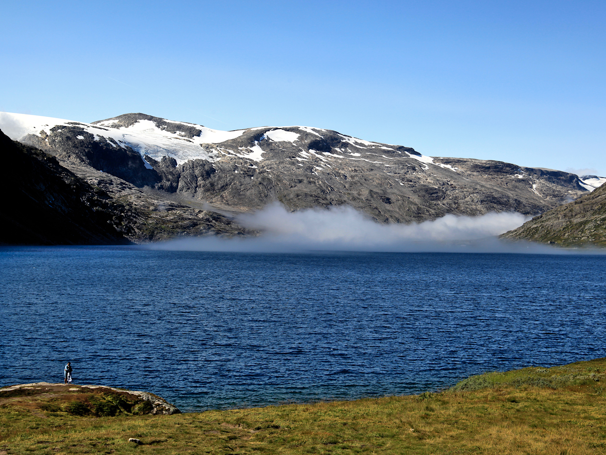

## NO Týden 30: Djupvatnet

Z oblasti Lomu jsem jel směrem na Geiranger. Kolem řeky Otta vystoupáte do hornaté oblasti (Breheimen nasjonalpark), kde je krásné údolí Breiddalen a mnoho pěkných jezer, například Breiddalsvatnet nebo Langvatnet. U některých jsem se zastavil a kochal se přírodou, o kousek výš - v nadmořské výšce 1400-1500 m - byl i v létě vidět sníh a led.

Nejkrásnější jezero se ovšem objevilo až kousek před sjezdem dolů do Geirangeru, jmenuje se Djupvatnet. Nabízí pohled na vodní hladinu, nad kterou je vidět ledovec (Skjerdingdalsbreen) a já měl to štěstí, že od Geirangeru po hladině postupovala mlha/mrak. Bylo docela těžké najít záběr, ve kterém by nebyli další turisté. Romantická dvojice u břehu jezera mi už tolik nevadila, tak jsem to cvaknul.

<https://en.wikipedia.org/wiki/Djupvatnet>

<https://www.tripadvisor.com/Attraction_Review-g190503-d21049002-Reviews-Djupvatnet-More_og_Romsdal_Western_Norway.html>

<https://www.visitnorway.dk/listings/breheimen-nasjonalpark/233657/>

<https://www.norgesnasjonalparker.no/en/nationalparks/breheimen/>

<https://no.wikipedia.org/wiki/Breiddalen>

<https://no.wikipedia.org/wiki/Skjerdingdalsbreen>

<https://no.wikipedia.org/wiki/Otta>

---

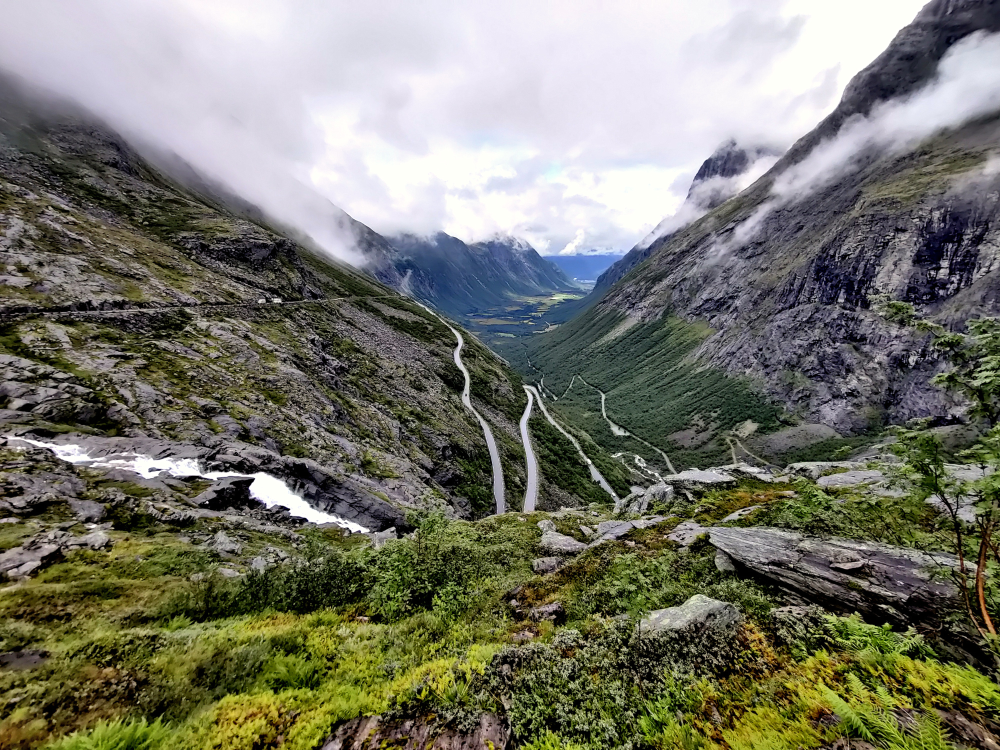

## NO Týden 31: Trollstigen

Geiranger měla být další pěkná zastávka na mé cestě, bohužel byla špatná viditelnost: mlha a déšť. S tím musíte v Norsku počítat, příroda vás odmění jen někdy. Ani město Ålesund jsem si pak úplně neužil, odpočíval jsem po dlouhém přejezdu.

Až další den jsem přejížděl do Åndalsnes - resp. do ubytování o jeden fjord dál - a po cestě se počasí umoudřilo. Nejmarkantnější byly změny počasí v okamžiku, kdy jsem zastavil nad slavnou vyhlídkou Trollstigen s vodopády a velkými serpentinami. Byl jsem optimista a vylezl jsem z auta ještě když jsme byli v mracích. Když jsem docházel na pár set metrů vzdálené vyhlídky, mraky začaly ustupovat a já už tušil, že dnes něco pěkného uvidím a nafotím.

Na fotografii v kalendáři vidíte pohled na serpentiny a do údolí řeky Istra, kterou jsem později sledoval až do jejího konce v řece Rauma, vlévající se do Isfjordalen poblíž města Åndalsnes. To není na fotografii zřetelně vidět, ale můžete to tušit tam v dálce.

Výhledy na všechny strany jsem se kochal asi hodinu, byl vidět nedaleký vrchol s působivými skalami Bispen (1462m), několik menších vodopádů a čilý automobilový ruch na serpentinách Isterdalsvegen. Občas se opravdu musel provoz zastavit a počkat, až se nějaký delší autobus opatrně vytočí v jedné z ostrých zatáček.

<https://no.wikipedia.org/wiki/Isfjorden_(fjord_i_Rauma)>

<https://no.wikipedia.org/wiki/Trollstigvegen>

<https://www.fjordnorway.com/en/see-and-do/national-tourist-route-trollstigen>

<https://www.visitnorway.com/listings/the-bishop-s-hike-to-bispen/271661/>

<https://www.europeanwaterfalls.com/waterfalls/stigfossen-trollstigen/>

---

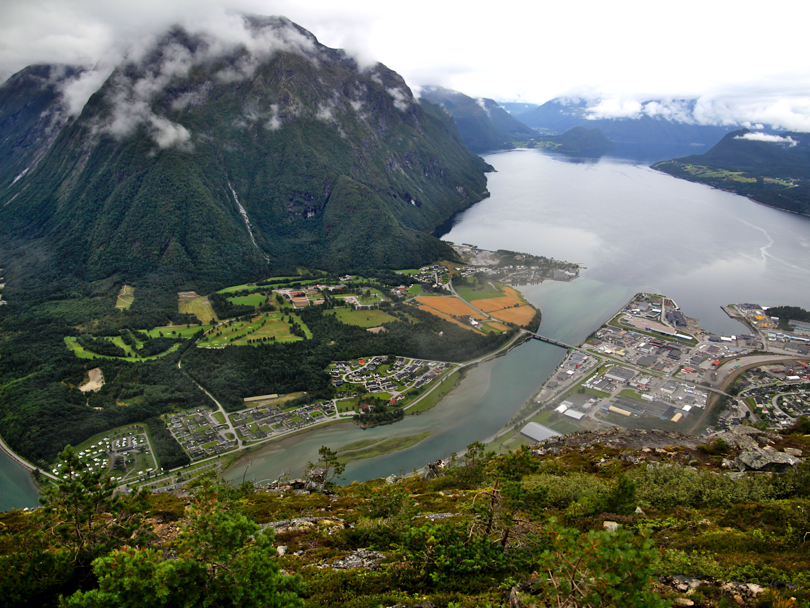

## NO Týden 32: Romsdalsfjorden from Nesaksla

Přímo v Åndalsnes jsem nebydlel, ale udělal jsem si tam výlet. Lanovkou jsem vyjel na kopec Nesaksla (715 metrů), užil výhledy do několika stran a fotil Romsdalsfjorden i údolí Romsdalen, odkud jsem předchozí den přijel. Na vrcholu je východiště několika pěších túr a též možnost sejít dolů do údolí po jedné z dvou ferrat. Neměl jsem ideální počasí (okolní vrcholy v mracích) ani dostatečně dobré boty, tak jsem jen udělal krátký okruh na vrcholu a dolů sjel opět lanovkou. Pokud byste Åndalsnes navštívili za lepšího počasí, lépe vybaveni a v lepší fyzické formě, určitě si nějaký lepší výlet naplánujte!

Ve městě končí železniční trať "Raumabanen railway", měl jsem štěstí a mohl jsem se podívat na zlatý vlak, který zrovna přijel. Vypadá to, že "Rauma Line" je jedna z nejkrásnějších tratí v Evropě. Jízda po 114km dlouhé trati trvá méně než dvě hodiny a musí to být skvělý zážitek.

<https://en.wikipedia.org/wiki/%C3%85ndalsnes>

<https://www.fjordtours.com/en/norway/places-to-visit/fjords/romsdalsfjord>

<https://www.visitnorway.com/places-to-go/fjord-norway/northwest/andalsnes/>

<https://en.wikipedia.org/wiki/%C3%85ndalsnes_Station>

<https://www.visitnorway.com/plan-your-trip/getting-around/by-train/rauma-line/>

<https://www.sj.no/en/strekning/raumabanen-2/>

<https://www.instagram.com/thegoldentrain>

---

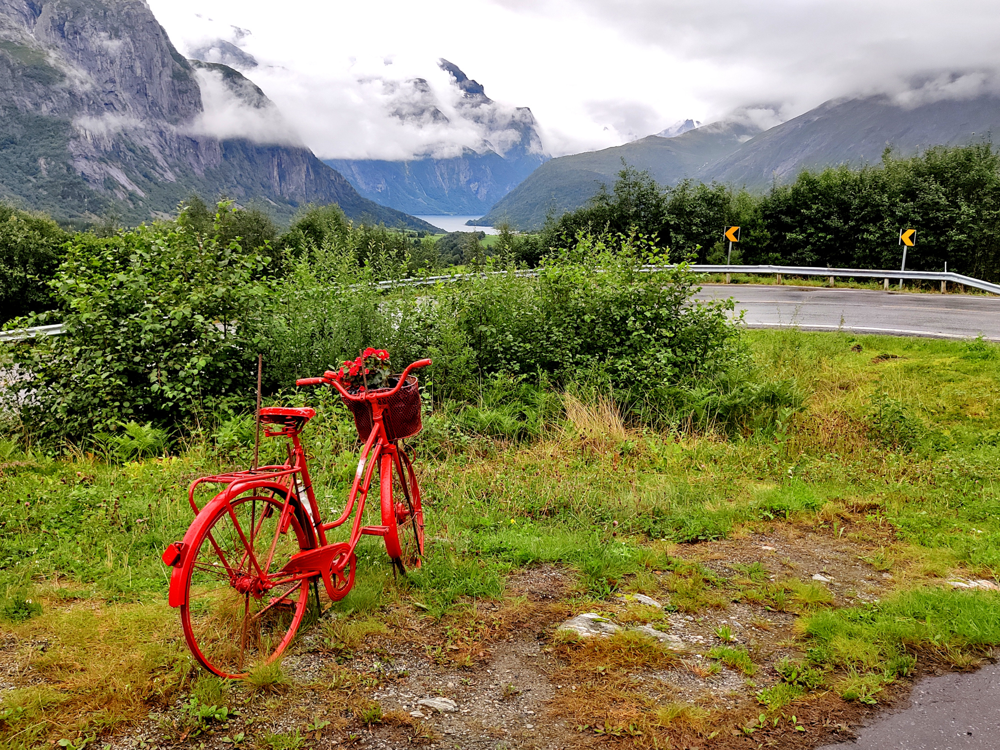

## NO Týden 33: Storsvingen

Podle mraků na fotografii už jste si možná domysleli, že jsme pořád nedaleko Åndalsnes v prostoru i čase. Vyjel jsem si obhlédnout Eresfjord a nevyužít přitom trajekt Åfarnes ferjekai. Objevil jsem například malé lyžařské středisko Vistdalsheia s několika běžkařskými okruhy (není na fotce).

Ale ostrá zatáčka s odpočívadlem se už do kalendáře dostala. Zejména díky krásnému výhledu na jihovýchod s horou Goksøyra (1337 m) a jezerem Eikesdalsvatnet. Jedno z barevných jízdních kol propagujících cyklistiku (viz odkaz dole - Bygda Rundt) ještě vylepšilo ten pěkný snímek.

<https://climbfinder.com/en/climbs/vistdalsheia-eresfjord>

<https://morotur.no/tur/lysloeypa-vistdalsheia>

<https://en.wikipedia.org/wiki/Eresfjorden>

<https://www.alltrails.com/norway/more-og-romsdal/eresfjord>

<https://www.eresfjord.no/sykkelbygda-eresfjord>

<https://www.eresfjord.no/lagorg/eresfjord-il/bygda-rundt>

<https://en.wikipedia.org/wiki/Eikesdalsvatnet>

<https://dovrefjell-sunndalsfjella.no/en/approaches-and-starting-points/eikesdal/>

---

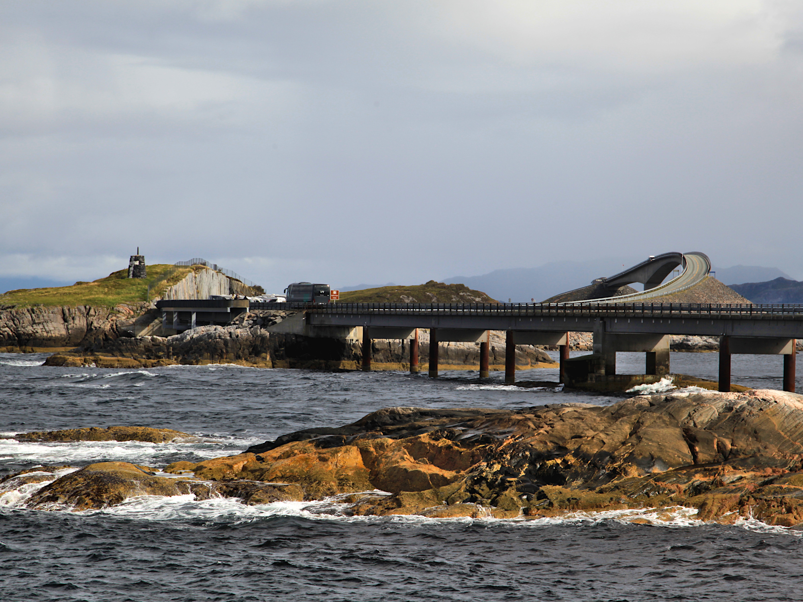

## NO Týden 34: Atlanterhavsvegen

Další úsek mé cesty vedl do Kristiansundu a bylo mou povinností použít silnici č. 64 se slavnou Atlantickou cestou (Atlanterhavsvegen) a ikonickým mostem Storseisundbrua. Měl jsem slušné počasí, tak jsem se zastavil na parkovišti Skipsholmen a prohlédl si okolí. Mosty, malé ostrůvky, příboj, z jedné strany Norské moře a z druhé klidnější Kornstadfjorden. Rozhodně to místo stojí za návštěvu, jen pozor v chladnějších ročních obdobích. Při silném větru mohou vlny stříkat přes silnici a mosty a cesta se občas pro špatné počasí zavírá.

Ještě lepší záběry Atlantické cesty pořídíte dronem, viz odkazy níže.

<https://en.wikipedia.org/wiki/Atlantic_Ocean_Road>

<https://en.wikipedia.org/wiki/Norwegian_County_Road_64>

<https://no.wikipedia.org/wiki/Storseisundbrua>

<https://www.visitnorway.com/places-to-go/fjord-norway/northwest/scenic-route-atlantic-road/>

<https://www.visitnorway.com/listings/norwegian-scenic-routes-the-atlantic-road/26864/>

<https://www.colorfuljourneys.com/articles/atlantic-ocean-road-norway>

---

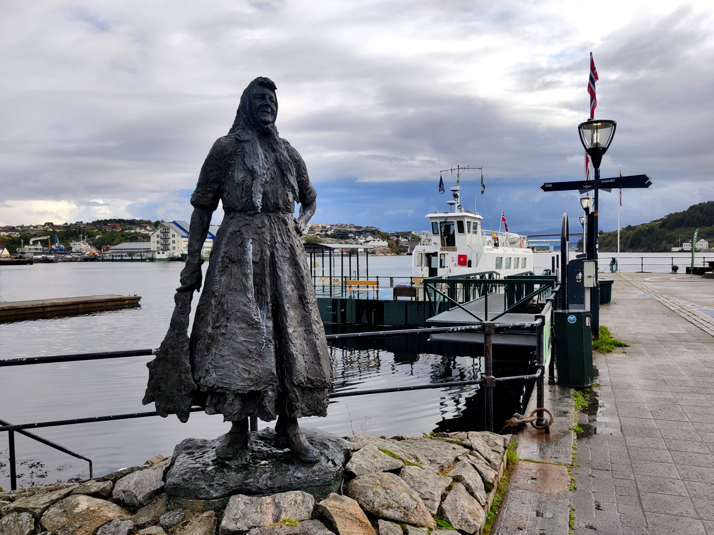

## NO Týden 35: Kristiansund

Kristiansund je velmi zajímavé město, nachází se na několika ostrovech propojených mosty a lodní dopravou - nejstarší veřejnou dopravou na světě - Sundbåten (od roku 1876). Funguje dodnes, ale já ji nevyzkoušel, protože jsem měl jiné plány. Prohlédl jsem si přístav, zajímavou budovu Campus Kristiansund, zašel k malému majáku a vypravil se na výlet lodí. Tomu všemu bude věnováno několik příštích týdnů kalendáře, vypadá to, že jsem si Kristiansund oblíbil.

Na fotografii je molo Piret se sochou Klippfiskkjerringa (Clipfish Woman), vytvořenou na počest dlouhé tradice lovu a zpracování ryb. "Klippfisk" je technologie konzervace, která spočívá v nasolení, usušení a slisování ryb, zejména různých druhů tresek. Žena drží v pravé ruce právě takto zpracovanou rybu.

<https://www.visitnorway.com/listings/sundbaten-the-harbour-ferry/26822/>

<https://www.sundbaten.no/en>

<https://www.visitnorway.com/listings/klippfiskkjerringa-sculpture/234148/>

<https://www.fjordnorway.com/en/inspiration/day-trips/kristiansund/experience-the-clipfish-town>

<https://www.instagram.com/sundbaten>

---

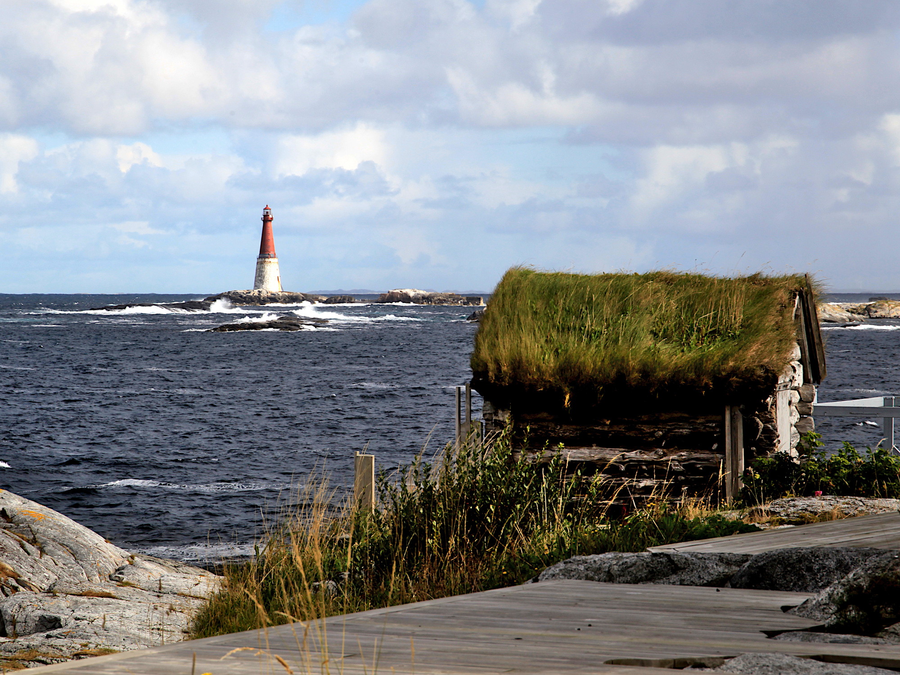

## NO Týden 36: Grip fyrstasjon

Asi nejzajímavějším výletem v Kristiansundu byl výlet malou lodí na ostrov Grip. Odjíždí se z mola Piret (viz foto z minulého týdne), loď se jmenuje MS Kvikk a cesta na Grip trvá přibližně 35 minut, podle počasí.

Na fotografii je maják Grip fyrstasjon vysoký 44m postavený na útesu Bratthårskollen, v provozu od roku 1888. Bylo obtížné tam sloužit, hlavně pro drsné podmínky a špatnou obsluhu z pevniny. Od roku 1977 byl maják automatizován a dnes je již bez trvalé lidské obsluhy, detaily a další historky si můžete přečíst na webové stránce v posledním odkazu.

Fotografie byla pořízena ze severní části ostrova Grip, přibližně z místa označeného Hotta.

<https://www.gripruta.no/en>

<https://www.gripruta.no/en/trips>

<https://www.marinetraffic.com/en/ais/details/ships/shipid:306578/mmsi:257398700/imo:0/vessel:KVIKK>

<https://www.kystverket.no/kystkultur/fyrstasjoner/grip-fyr/>

<https://www.instagram.com/gripruta>

---

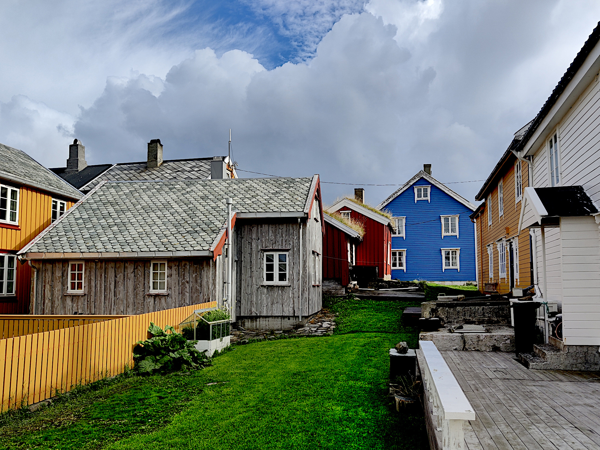

## NO Týden 37: Grip

Grip je ostrov s dlouhou rybářskou historií. Obyvatelé měli těžký život a denně bojovali s drsnou přírodou. Skoro všichni muži jezdili na moře lovit ryby. Pokud se přihnala silná bouře, nezřídka se domů nevrátili všichni, o extrémních případech vyprávějí kroniky:

23. února 1625 zasáhl orkán na Foldě rybářskou flotilu tak silně, že se domů nevrátil ani jeden muž z Gripu schopný rybolovu - šlo o 210 mužů, děti a matky zůstávaly doma. Vdovy se často později znova vdávaly a umožnily tak zachovat kontinuitu svých rodin.

Kolem roku 1640 postihla Grip mimořádná "mořská pohroma" ("HavsVaade" - detailní popis, o jakou kombinaci ničivých sil se jednalo, archivy neuvádějí), při níž zahynula většina místních rybářů, byl poničen přístav a většina větších lodí prakticky přestala existovat.

Ostrov pro mne představuje symbol norů žijících v drsné přírodě, kteří se těžce rvou o své živobytí a neustále chovají k přírodě velký respekt.

Na fotografii je jedna z malebných uliček ostrova s barevnými domky, dnes již dobře rekonstruovanými a moderně vybavenými.

<https://en.wikipedia.org/wiki/Grip,_Norway>

<https://www.gripruta.no/en/trips>

<https://skillingsviser.no/dodskampen-pa-foldahavet/>

<https://no.wikisource.org/wiki/Bidrag_til_Christianssunds_Historie_indtil_1814>

<https://lokalhistoriewiki.no/Grip>

<https://www.instagram.com/gripruta>

---

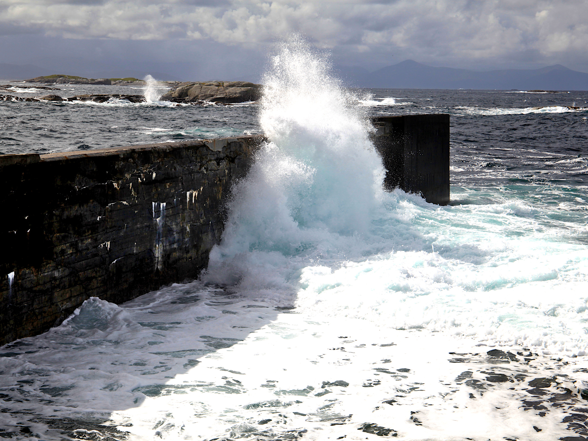

## NO Týden 38: Elementer, Grip

Tato fotografie ilustruje sílu mořských živlů (vody, větru), které se projevovaly i v relativně klidném dnu uprostřed léta 2025. Na ostrov jsme jeli menší lodí MS Kvikk (66 stop, další parametry viz odkaz) a neměli jsme žádné problémy - jen lidé se slabším žaludkem si museli dávat pozor.

Do severní části ostrova Grip se jménem Notbeget mne přilíkaly právě vlnolamy, o které se tříštily vlny. Došel jsem až skoro na konec vlnolamu "Kvalhaue" a trpělivě natáčel videa a fotografoval, výsledkem je jedna z fotografií v kalendáři ukazující sílu živlů.

<https://www.gripruta.no/en>

<https://www.gripruta.no/en/trips>

<https://www.marinetraffic.com/en/ais/details/ships/shipid:306578/mmsi:257398700/imo:0/vessel:KVIKK>

---

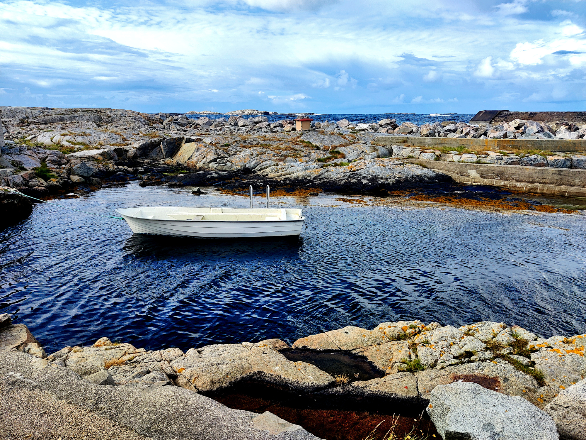

## NO Týden 39: Grip

Na ostrově Grip se rybářství provozuje dodnes. Strávil jsem tam pár hodin, prohlédl si kostel (Grip stave church) a vyslechl si tam našeho průvodce. Ve zbytku času jsem chodil po ostrůvku a užíval si dalších míst a scenérií. Malá hasičská stanice je zajímavá, i obchod (Grip kro) nebo fotbalové hřiště stojí za návštěvu.

Mne zaujal pohled na malou zátoku se zaparkovaným člunem, a tak se do kalendáře dostala právě tato fotografie.

<https://www.gripruta.no/en>

<https://en.wikipedia.org/wiki/Grip,_Norway>

<https://no.wikipedia.org/wiki/Grip_stavkirke>

